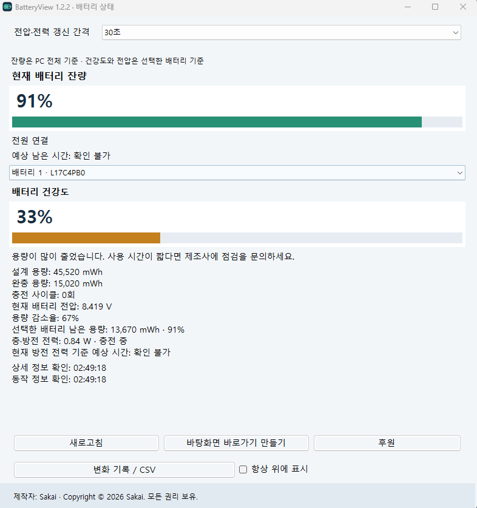

# BatteryView 1.2.2

**A lightweight Windows battery health and monitoring utility.**  
**Windows 노트북 배터리 상태·건강도 모니터링 프로그램**



[](https://github.com/M26Pershing90mm/NotebookBatteryView)


BatteryView is a lightweight Windows Forms utility written in C# for inspecting notebook battery condition, capacity and charging information. It reads the information available through Windows and battery drivers, plots session history and exports samples to CSV.

BatteryView는 Windows 및 배터리 드라이버에서 제공하는 정보를 활용해 배터리 잔량, 건강도, 충·방전 상태, 전압과 용량을 확인하는 경량 프로그램입니다. 측정 기록의 그래프 표시와 CSV 내보내기도 지원합니다.

> [!NOTE]
> This software is **free for personal, non-commercial use only**. It is **source-available, not open source**. See [LICENSE](LICENSE).
>
> 개인의 비상업적 사용은 무료입니다. **상업적 사용과 무단 재배포는 허용되지 않습니다.** 상세 조건은 [LICENSE](LICENSE)를 참고하세요.

## Features / 주요 기능

- **Battery charge / 현재 배터리 잔량:** system-wide charge percentage, AC power connection state and estimated remaining runtime when available.
- **Battery health / 배터리 건강도:** estimates health from full-charge capacity ÷ design capacity × 100.
- **Capacity / 용량:** displays design capacity, full-charge capacity and remaining capacity when reported by the driver.
- **Charge cycles / 충전 사이클:** displays cycle count when supported by the battery driver.
- **Voltage and power / 전압과 전력:** displays battery terminal voltage and available charging/discharging rate information.
- **Multiple batteries / 다중 배터리:** select a battery for device-specific details.
- **Refresh settings / 갱신 간격:** manual, 30, 60, 90, 120 or 300 seconds for voltage and charging-rate updates.
- **Session history / 세션 기록:** charge and power-rate graphs, sample table and CSV export (up to 2,000 in-memory samples).
- **Localization / 다국어 UI:** Korean, English and Japanese, selected automatically according to Windows UI language.
- **Convenience / 편의 기능:** always-on-top mode and a user-initiated desktop shortcut.

> Battery health is a **capacity estimate, not a battery safety diagnosis**. Not all batteries/drivers expose all fields; unavailable measurements are shown as unavailable rather than inferred. The app's 80% and 60% health bands are guidance, not manufacturer replacement criteria.
>
> 배터리 건강도는 **용량 기반 추정치**이며 안전성 진단이 아닙니다. 제조사 및 드라이버에 따라 일부 정보가 제공되지 않을 수 있습니다.

## Requirements / 시스템 요구 사항

| Item | Requirement |
| --- | --- |
| Operating system | Windows; designed for notebook/laptop battery monitoring |
| Runtime | Microsoft .NET Framework (application targets **4.5**; use an up-to-date supported Windows/.NET Framework configuration, preferably 4.8/4.8.1 where applicable) |
| Implementation | C# / Windows Forms |
| Battery details | Windows battery driver and WMI support |
| Administrator privileges | Not requested by the executable manifest |

> The target framework is 4.5, but **.NET Framework 4.5 itself is out of support**. Validation against every Windows version and laptop model has not been completed.

## Download and Run / 다운로드 및 실행

1. Download `BatteryView.exe` from [this repository](BatteryView.exe), or obtain an officially published build from [Releases](https://github.com/M26Pershing90mm/NotebookBatteryView/releases) if one is available.
2. Save the executable to a directory you control.
3. Run `BatteryView.exe` on Windows. No separate installer is provided.
4. Click **Refresh / 새로고침** to retrieve detailed battery information. Select a battery if more than one is detected.
5. Open **History / CSV (변화 기록 / CSV)** to view session graphs and export collected samples.

**한국어:** 저장소의 `BatteryView.exe`를 다운로드해 Windows에서 실행합니다. 상세 정보를 보려면 **새로고침**을 누르고, 기록을 CSV로 저장하려면 **변화 기록 / CSV**를 선택하세요.

> Only download executable files from the official repository. Verify the file hash below before running. Antivirus detections must be reviewed rather than automatically ignored.

## Build from Source / 소스코드 빌드

The repository includes the source files and a Windows build script. On a suitable Windows system with the .NET Framework C# compiler available:

```bat
Build.bat
```

The script invokes the installed .NET Framework `csc.exe` to compile the WinForms application with `BatteryView.ico` and `BatteryView.manifest` into `BatteryView.exe`. Keep the `.cs` sources, icon, manifest and build script in the same folder. The build does not use NuGet packages.

**주의:** `Build.bat` 실행 시 같은 폴더의 `BatteryView.exe`를 다시 생성하거나 교체합니다. 기존 실행 파일은 별도로 보관하세요. Rebuilt binaries are not guaranteed to have the same SHA-256 hash as the distributed executable.

## File Integrity / 파일 무결성

The SHA-256 below identifies the **original BatteryView.exe v1.2.2** provided with this project:

```text
File:    BatteryView.exe
Version: 1.2.2
SHA256:  013b187ce5c174e36e64d1787908c16631b29683c69a0ce8114740e944aa6f6e
```

On Windows PowerShell:

```powershell
Get-FileHash .\BatteryView.exe -Algorithm SHA256
```

The hash must be compared with the particular published build you obtained; a locally rebuilt or later version may differ. Hash matching confirms file identity, **not malware-free status**.

## Antivirus Detection Notice / 백신 탐지 및 오진 의심 안내

Some VirusTotal antivirus engines have identified the **v1.2.2 executable** using the following detection names. The detections **may be false positives**, but that has **not been independently established or confirmed by the vendors**.

일부 보안 엔진이 BatteryView 1.2.2 실행 파일을 악성코드 의심 대상으로 탐지했습니다. 해당 결과는 **오진 가능성이 있지만, 아직 오진으로 최종 확인된 것은 아닙니다.**

| Security vendor / 보안 업체 | Detection name / 탐지명 |
| --- | --- |
| MaxSecure | `Trojan.Malware.300983.susgen` |
| McAfee Scanner | `Ti!013B187CE5C1` |
| Palo Alto Networks | `Generic.ml` |
| TEHTRIS | `Generic.Malware` |

**[View the VirusTotal report / VirusTotal 탐지 결과 확인](https://www.virustotal.com/gui/file/013b187ce5c174e36e64d1787908c16631b29683c69a0ce8114740e944aa6f6e/detection)**

- These vendor names and labels reflect the **reported results**; detection results can change over time.
- Generic or machine-learning-based labels do not by themselves identify a confirmed malware family; they also **do not prove a false positive**.
- Review the source, check the executable hash and assess the current scan results before use.
- If you believe a detection is incorrect, submit the binary to the relevant security vendor for review. **Do not disable antivirus protection merely to run the application.**

## Data Handling & Security / 데이터 처리 및 보안

The source code reads local Windows power information and battery WMI information. Its documented behavior does **not** implement automatic battery-data uploads or a network listening service. The **Support / 후원** button opens an external support URL only when clicked.

- Session history is retained **in memory** while the app runs; CSV export is user-initiated and saved to a user-selected path.
- The application can create error logs under `%USERPROFILE%\Desktop\BatteryView-Errors\` when errors occur.
- Creating a desktop shortcut is also user-initiated.
- The executable does not request elevation in its manifest.
- The executable is **not Authenticode-signed**.

A project security review is available in [SECURITY-AUDIT-ko.md](SECURITY-AUDIT-ko.md). It documents source-level checks, previous hardening and testing limitations; **it is not an independent malware-free certification**. Some GUI and security checks were conducted in a controlled Mono environment, not across actual Windows hardware.

## Troubleshooting / 문제 해결

- **No battery detected:** This can be normal on desktop computers. Check the laptop battery and its Windows driver.
- **Unknown voltage, capacity or cycles:** Some battery drivers do not expose these metrics.
- **Refresh fails:** Check battery driver status, Windows management services and local security policies.
- **CSV export fails:** Choose a writable location and verify filesystem permissions.
- **Startup problem:** Verify the installed .NET Framework and Windows environment.
- **Antivirus alert:** Read the detection notice above and request vendor review if necessary; do not bypass security warnings blindly.

## License / 라이선스

**Copyright © 2026 Sakai. All rights reserved.**

BatteryView is distributed under the **BatteryView Personal Non-Commercial License v1.0**:

- Free to download and use for private, personal, non-commercial purposes.
- Private source inspection and modification for personal non-commercial use are permitted.
- Commercial, business and professional use requires prior written permission.
- Unauthorized redistribution, re-uploading, repackaging, resale and distribution of modified builds are prohibited.
- Sharing a link to this official GitHub repository is permitted.

**개인 비상업적 이용만 무료**이며, 기업·업무·영리 목적 사용과 무단 복제 배포·재업로드는 금지됩니다. 개인적인 학습 및 비공개 수정은 라이선스 조건 내에서 허용됩니다.

Read the complete terms in **[LICENSE](LICENSE)**. This is **not** an OSI-approved open-source license. Applicable GitHub platform rights and statutory exceptions remain unaffected.

## Project Links

- [Repository](https://github.com/M26Pershing90mm/NotebookBatteryView)
- [Screenshot](BatteryView.png)
- [Source build script](Build.bat)
- [License](LICENSE)
- [Issues and feedback](https://github.com/M26Pershing90mm/NotebookBatteryView/issues)

---

**BatteryView 1.2.2 · Developed by Sakai · Copyright © 2026 Sakai**
